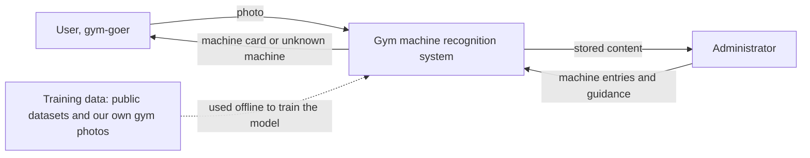
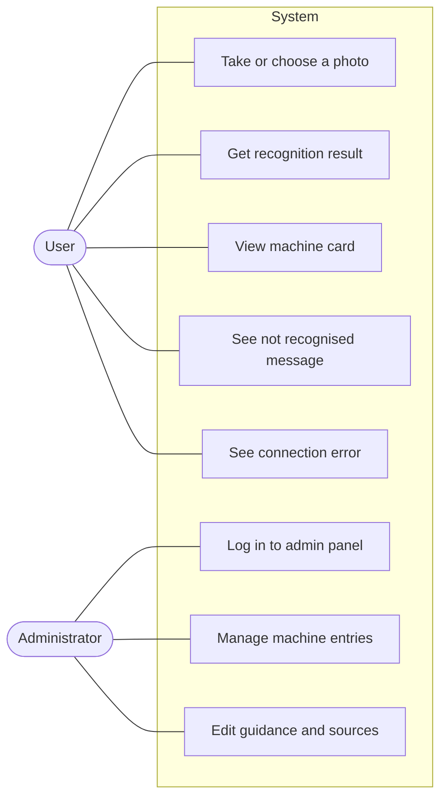
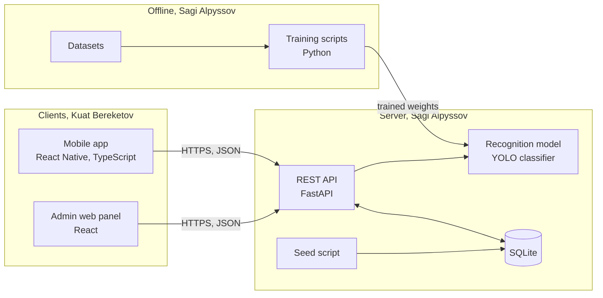
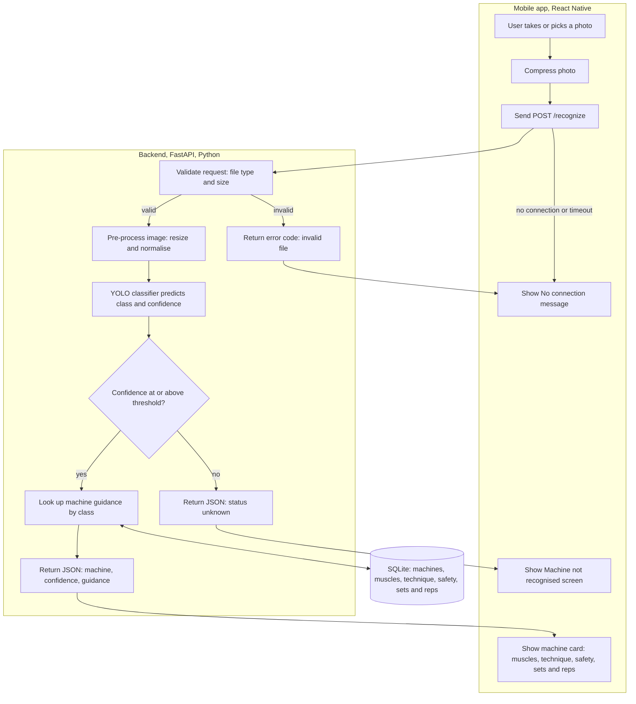
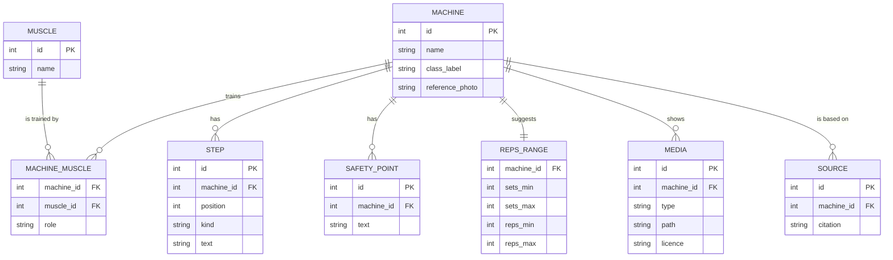

# Application for Exercise Equipment Recognition and Usage Recommendations Based on Artificial Intelligence

Diploma project, Astana IT University, Software Engineering. Team: Alpyssov Sagi Serikovich and
Bereketov Kuat Kairatuly. Supervisor: Turarova Marzhan Kabdykalievna.
First pre-defense: 24 October 2026.

A mobile app that recognises a gym machine from a photo and returns usage guidance for
it: target muscles, basic technique, machine setup, safety points and a suggested
starting set and repetition range.

## Contents

1. [Project proposal](#1-project-proposal)
2. [Relevance of the problem](#2-relevance-of-the-problem)
3. [Literature review](#3-literature-review)
4. [Existing systems](#4-existing-systems)
5. [Technology comparison](#5-technology-comparison)
6. [Requirements](#6-requirements)
7. [Architecture and diagrams](#7-architecture-and-diagrams)
8. [UX and prototype](#8-ux-and-prototype)
9. [Verification plan](#9-verification-plan)
10. [Project management](#10-project-management)
11. [Supervisor feedback](#11-supervisor-feedback)

## Repository

```
README.md        this file: all components
prototype_design/ Folder containing link to Figma project 
backend/         FastAPI service and SQLite seed script
training/        model training and evaluation scripts
mobile/          React Native app, Expo, TypeScript
admin/           admin web panel, React
docs/design/     exported Figma screens
tests/           automated tests
.gitignore
```

### Working rules

- One repository. Each member commits from their own account.
- Every task has a YouTrack ID from the project DIP. It appears in the branch name, for
  example `feature/DIP-12-short-name`, in each commit message, for example
  `[DIP-12] short message`, and in the pull request title.
- Every change goes in through a pull request that the other member reviews.
- Submitted versions are tagged: `prob-period-1`, and so on.

### License

The repository is licensed under AGPL-3.0, the same licence as Ultralytics YOLO, which the
recognition component uses. See 1.12 and 5.6.

---

## 1. Project Proposal

### 1.1 Title

Application for Exercise Equipment Recognition and Usage Recommendations Based on
Artificial Intelligence

### 1.2 Team and supervisor

| Role | Name | Responsibility |
|------|------|----------------|
| Team member | Sagi Alpyssov | Literature review; recognition model and evaluation; backend and inference service in Python with FastAPI; SQLite database; architecture; technology comparison; repository and YouTrack setup |
| Team member | Kuat Bereketov | UI/UX design and Figma prototype; mobile app in React Native with TypeScript; admin web panel in React; integration of the API with the clients and integration testing; analysis of existing apps; guidance content; usability testing |
| Supervisor | Marzhan Turarova | Reviews key deliverables and pull requests |

First names are used in the rest of this document.

Shared: proposal, requirements, interviews, risk list, and the API contract between the
app and the backend. Each member reviews the other's pull requests.

### 1.3 Problem

People who are new to the gym are often unsure what a machine trains, how to adjust it and
how to use it safely, and a personal trainer is not always available or affordable. They
search for the machine's name, watch videos that disagree with each other, or skip the
machine. In a quiz of 310 exercise professionals the average score on technique analysis
was 50% (Petushek et al. 2026), and the evidence on how technique relates to injury is
still thin (Noteboom et al. 2024).

Camera-based systems in the scientific literature check how a person moves, see section 3.
None of the sources we reviewed starts from a photo of the machine and returns guidance
for it. Some mobile apps already recognise gym machines from a photo, see section 4, so
recognition itself is not the new part. The project offers a free app for Android and iOS
with sourced guidance, an "unknown machine" answer, and accuracy measured on photos from
real gyms.

Four interviews, section 2, partly support the problem. One beginner was unsure how to
adjust a machine, had skipped machines, and later found their technique was probably
wrong. One returning gym-goer relied on a family member and videos. Only two participants
are in the target group, so the problem is supported but not proven.

### 1.4 Users

- Beginners and casual gym-goers who don't know the machines.
- Regular gym-goers trying an unfamiliar machine.
- Trainers or coaches as secondary users. One coach asked for a list of cases where a
  machine should not be used.
- An administrator who maintains the machine entries.

### 1.5 Aim

To build a mobile application that recognises a gym machine from a photo and returns
usage guidance for it: target muscles, basic technique, machine setup, safety points and
a suggested starting exercise plan. The application is tested on photos taken in real
gyms.

### 1.6 Objectives

| # | Objective | Result at the end of the objective | Owner |
|---|-----------|------------------------------------|-------|
| 1 | Review the literature and existing apps | Literature review, comparison of existing systems | Sagi: literature; Kuat: apps |
| 2 | Check the need with real users | Notes from 3 to 5 conversations, findings separated from assumptions | Both |
| 3 | Define requirements | Functional and non-functional requirements with acceptance criteria | Both |
| 4 | Design the system | Context, use case and component diagrams, data model | Sagi; Kuat for the use case diagram |
| 5 | Build the recognition component | A model that classifies the machine classes, with a confidence threshold and an "unknown machine" answer | Sagi |
| 6 | Build the guidance content | A knowledge base with the guidance for each machine class, written from cited sources | Kuat |
| 7 | Build the app and admin panel | A mobile prototype where the user takes or chooses a photo and sees the result and guidance, and an admin web panel for the machine entries | Kuat: screens and panel; Sagi: API |
| 8 | Evaluate | Accuracy on a separate set of real-gym photos, integration tests, and a usability check with SUS | Sagi: accuracy; Kuat: usability and integration tests |

For the first pre-defense on 24 October 2026 the deliverables are objectives 1 to 4, the
Figma prototype, the verification plan and the project plan. Objectives 5 to 8 are planned
and started.

### 1.7 Scope

**In scope, first version**
- Recognition of a fixed list of popular gym machines from a single photo. The planned list
  has about 12 classes, such as leg press, lat pulldown, seated cable row, chest press
  machine, pec deck, leg extension, seated leg curl, shoulder press machine, Smith machine,
  cable crossover, hack squat and treadmill. The final list depends on the datasets.
- Guidance per machine: a reference photo, target muscles, how to adjust the machine,
  short technique steps, safety points and a suggested starting set and repetition range
  for beginners. Step images or a short animation for the technique, if time allows.
- An "unknown machine" answer when the model's confidence is low.
- A mobile app for Android and iOS built with React Native, a backend API, a database, and
  an admin web panel, a protected web page where machine entries are added and edited.

**Out of scope**
- Checking how the user performs the exercise. No pose estimation or form scoring.
- Medical advice, injury diagnosis or personalised rehabilitation plans. The app shows a
  general notice and a short list of cases to ask a professional about.
- Recommending a starting weight.
- Free weights and equipment outside the class list.
- User accounts, workout history, saved routines, warm-up plans, social features, payments.
- On-device inference. The first version runs the model on the server and needs a network
  connection. Offline use is future work.

Some of these functions appear in the prototype, see 8.4.

### 1.8 Approach and planned technology

| Part | Choice | Owner |
|------|--------|-------|
| Recognition | YOLO from Ultralytics in classification mode, trained on public datasets from Kaggle and Roboflow, with our own real-gym photos for testing. Alternatives compared in section 5: fine-tuned MobileNetV3, CLIP, EfficientNet or ResNet | Sagi |
| Backend and inference | Python with FastAPI: one service that loads the trained model, classifies the photo and returns the machine guidance as a REST API. Alternatives compared in section 5: Flask, Node.js with ONNX Runtime, on-device inference | Sagi |
| Database | SQLite for the machine knowledge base and optional scan history, accessed through SQLAlchemy so it can be replaced with PostgreSQL. Alternatives compared in section 5: PostgreSQL, MongoDB, Firebase Firestore | Sagi |
| Mobile app | React Native with Expo in TypeScript. Alternatives compared in section 5: Flutter, native Android with Kotlin, web app | Kuat |
| Admin panel | React web app | Kuat |
| Design and prototype | Figma | Kuat |

The project uses two languages: Python for the model and backend, and TypeScript for the
mobile app and the admin panel. The database is a single SQLite file filled by a seed
script, so the backend starts without a database server. Ultralytics is released under
AGPL-3.0, so the repository uses the same licence.

### 1.9 Why this is an engineering project and not only a model

The project combines computer vision with look-alike machines, different lighting and
angles and a small dataset; a client-server design with a model service; guidance content
that has to be written and sourced; and an evaluation on photos not used for training. It
also includes choosing between alternatives and handling the cases where the model should
not answer.

### 1.10 Expected outcomes

- A documented design and requirements, traceable in YouTrack and in the repository.
- A working prototype for the chosen machine classes, with measured accuracy.
- A report on what works, what does not and what was left out.

### 1.11 Preliminary success criteria

- Top-1 accuracy of about 85% or higher on a held-out set of real-gym photos.
- The app answers "unknown machine" instead of a wrong guess when confidence is low.
- Time from photo to result of a few seconds on a normal connection.
- SUS score reported from a small usability check, with the number of participants stated.

### 1.12 Risks

Likelihood L and impact I are rated Low, Medium or High. We review them every week. Each
risk is also a label in YouTrack.

| ID | Risk | L | I | Owner | Mitigation | Warning sign and fallback |
|----|------|---|---|-------|------------|---------------------------|
| R1 | The datasets from Kaggle and Roboflow have too few or poor photos for some machines | H | H | Sagi | Audit each dataset per class first; add our own photos; use transfer learning and augmentation; check each dataset's licence before using it | A class has far fewer images than the others: drop it from the class list |
| R2 | Similar-looking machines get confused, such as chest press and shoulder press | M | M | Sagi | Report the confusion matrix; use a confidence threshold; merge classes that cannot be told apart | Two classes confused in a large share of test photos: merge or remove one |
| R3 | Photos from real gyms differ from the training data in lighting, angle and crowding | H | H | Sagi | Keep a separate real-gym test set from the start, split by gym and not randomly | Accuracy on the real-gym set is much lower than on the public set: collect more real-gym photos and retrain |
| R4 | Evaluation looks better than it is because similar photos are in the training and test sets | M | H | Sagi | Split by gym or session; never tune on the test set; report the setup in the verification plan | Test accuracy is suspiciously high: check the split for overlap |
| R5 | Licensing of the model library, Ultralytics AGPL-3.0 | M | M | Sagi | The repository uses AGPL-3.0, the same licence; do not copy Ultralytics code into the repository; keep the alternative models from the comparison | A need to distribute the app under other terms: switch to MobileNetV3 or EfficientNet |
| R6 | The guidance is wrong or unsafe and a user follows it | M | H | Kuat | Write every guidance entry from cited sources; state that it is not medical advice; ask the supervisor or a qualified trainer to review the content; do not recommend weights | A source is missing for an entry: remove the entry until it has one |
| R7 | The interviews do not confirm the problem, or we cannot find enough people | M | H | Both | Keep findings and assumptions separate, section 2; interview one more beginner if possible | Not enough support: tell the supervisor and keep the claim in 1.3 weak |
| R8 | Server-side inference needs a connection, which may be weak inside a gym | M | M | Sagi | Compress the photo before upload; show a clear offline message; on-device inference is listed as future work | Response time on gym wifi is too long: shrink the image further or cache results |
| R9 | The SQLite file is lost if the host resets its disk | L | L | Sagi | Rebuild the database from a seed script at start-up; keep the knowledge base in the repository | Database empty after a restart: run the seed script |
| R10 | Photos may show other people in the gym, a privacy risk | M | M | Both | Do not store uploaded photos by default; take test photos without faces or with consent; keep the dataset out of public view if it contains people | A photo shows an identifiable person: delete it |
| R11 | One member is unavailable or the workload is uneven | M | M | Both | Documented split of work; each member reviews the other's pull requests so both know the whole project; weekly check on progress in YouTrack | A task is late for a week: move it or reduce the scope |
| R12 | Kuat's workload is high: design, mobile app, admin panel, content and tests | M | M | Kuat | Do the admin panel last; if it is late, the content stays in the seed script; Sagi helps with the API contract and tests | The mobile app is not working by the agreed date: move the admin panel to the next stage |
| R13 | Scope grows, for example accounts, history, more machines or starting weights | M | M | Both | Keep to 1.7; write new ideas under future work, not into the plan | A task is not in 1.7: do not start it |
| R14 | Not enough time before 24 October | H | M | Both | Pre-defense 1 is documents and the prototype; the model is planned for the next stage; order of work follows 1.13 | A component is not started by 20 October: tell the supervisor |
| R15 | Technique images or videos may be copyrighted | M | M | Kuat | Use our own photos or drawings, or openly licensed material; record the licence in the database | Licence unclear: do not use the item |
| R16 | The interview sample is small and not representative | H | M | Both | State the limits in 2.7; do not claim more than the interviews show | A decision depends on one interview only: check it again in the usability test |

### 1.13 Plan for pre-defense 1

Literature review and relevance interviews are done. Existing systems, technology
comparison, requirements, architecture diagrams, Figma prototype, verification plan and
project plan are prepared for 24 October 2026, and this README is submitted with the tag
`prob-period-1`.

---

## 2. Relevance of the Problem

### 2.1 Purpose

Section 1.3 says that beginners can be unsure how to use gym machines safely. This section
records four conversations and shows which claims they support. With four participants the
findings are indications, not proof.

### 2.2 Method

- Participants: two beginners or returning gym-goers, one person who does not go to the
  gym, and one gym coach.
- The interviews were text conversations in Messenger on 12 October 2026.
- Each participant answered the 16 questions in 2.3 in the order given. The idea of the app
  was shown only before question 11.
- Participants are anonymous, P1 to P4.
- Negative and critical answers are recorded the same way as positive ones.

### 2.3 Interview guide

1. How often do you go to the gym, and how long have you been going?
2. How did you learn what to do there at the start?
3. Think of the last time you used a machine you weren't sure about. What happened?
4. How do you usually find out what a machine trains and how to use it?
5. What is hard or annoying about that?
6. Have you ever skipped a machine, or realised later that you used one wrongly? What happened?
7. Do you ever worry about getting hurt on a machine? When?
8. How do you decide how many sets and repetitions to do on a machine?
9. Which apps, sites or videos do you use for gym advice? What do you like or dislike about them?
10. Have you ever paid for a trainer or a programme? Why, or why not?
11. What is your first reaction to an app that identifies a gym machine from a photo and explains how to use it? The idea was shown to the participant just before this question.
12. Would you use it? When exactly?
13. What would make you not trust the answer?
14. What would you want to see first on the result screen?
15. What would make you stop using such an app?
16. Is there anything about learning gym machines that I haven't asked and you think matters?

### 2.4 Interview log

| ID | Date | Participant type | Format |
|----|------|------------------|--------|
| P1 | 12 October 2026 | Does not go to the gym, works out at home | Messenger, text |
| P2 | 12 October 2026 | Beginner, goes 3 to 4 times a week, about a year | Messenger, text |
| P3 | 12 October 2026 | Returning gym-goer, about a year, a two-year break, now back | Messenger, text |
| P4 | 12 October 2026 | Gym coach, goes every day | Messenger, text |

### 2.5 Findings

| Claim from the proposal | What participants said | Result |
|-------------------------|------------------------|--------|
| C1. Beginners can be unsure what a machine trains or how to use it | P2 was unsure how to adjust the seat and where to put the hands, has skipped machines and later found their technique was probably wrong. P3 relies on the sign and a family member, and watched videos to improve technique. P1 has no gym experience. P4 is a coach. | Partly confirmed |
| C2. They currently search, ask someone or skip the machine | P2: YouTube or Google, sometimes asks an experienced person, has skipped machines. P3: the sign, a family member, YouTube, Instagram trainers. P4: asks other coaches. P1 said what they would do: YouTube or a manual online. | Confirmed |
| C3. A trainer is not always available or affordable | P2 has not paid for a trainer, is saving money, and says trainers can be expensive. P3 had free help from a family member. P1 does not feel the need. | Partly confirmed, only P2 gives cost as a reason |
| C4. They would use a photo-based app | P2 and P3: yes. P1: not regularly, but would consider it at an unfamiliar machine. P4 did not say whether he would use it. | Confirmed by the two gym-goers, conditionally by P1 |
| C5. They would trust short guidance from such an app | P1 and P2 would not trust it if it identified the wrong machine. P1 also if it contradicted the safety text on the machine. P2 also if everyone got the same advice. P3 would stop trusting it after an injury. P4 would trust it if he felt the muscle. | Conditional: trust depends on correct recognition and safe, consistent advice |

Findings that were not in the proposal:

| # | Finding | Who |
|---|---------|-----|
| F1 | Wants to see the technique demonstrated, in a video or a short demonstration, not only text | P1, P2, P3, P4 |
| F2 | Wants guidance on how to adjust the machine, such as seat height and handle position | P1, P2 |
| F3 | A wrong machine name breaks trust most; not knowing the name also makes searching hard | P1, P2, P3 |
| F4 | Wants short information, not long text, with the name and muscles first | P1, P2, P3 |
| F5 | The app should be fast, with no ads and no paywall for basic features | P1, P2, P3 |
| F6 | Sources contradict each other and it is hard to tell which are reliable | P1, P2 |
| F7 | Would stop using the app once the technique is learned | P3, P4 |
| F8 | Wants a warm-up plan for the muscle group of the machine | P3 |
| F9 | Wants to save learned machines and build a routine | P2 |
| F10 | Asking other people can feel embarrassing, and an app could give confidence | P2 |
| F11 | The coach wants a list of cases where a machine should not be used, such as scoliosis or diastasis recti | P4 |
| F12 | Wants a recommended starting weight | P2 |

### 2.6 What changes in the project

1. **Result screen.** The order is machine name and reference photo, target muscles, short steps, safety points, then sets and repetitions. The photo lets the user check that the machine was recognised correctly. Findings F3 and F4.
2. **Machine setup field.** Seat, handles and adjustments are added to the knowledge base and the requirements. Finding F2.
3. **Technique demonstration.** Step images or a short animation for each machine, and short videos only if time allows. This adds content work and a licensing check, R15. Finding F1.
4. **Safety notices.** A general notice and a short "ask a professional if" list reviewed by a qualified trainer. It stays general and is not medical advice. Findings F11 and F6.
5. **Future work.** Warm-up plans, F8, saved machines and routines, F9, personalised advice, and starting weight, F12. We do not recommend weights because a wrong number is a safety risk.
6. **Non-functional requirements.** Fast answer, no ads, and basic features free. Finding F5. Payments stay out of scope.
7. **Verification plan.** P3 and P4 would stop using the app once they know the technique, F7, so low long-term use is not a failure. We measure task success and SUS, and read usage over time carefully.
8. **Users.** The coach, P4, supports keeping trainers as secondary users.

### 2.7 Limits of these interviews

- Four participants, and only P2 and P3 are target users. P1 does not go to the gym and P4 is a coach.
- P1's answers are partly hypothetical and P4's answers are short.
- P4's answers do not follow the numbering of the guide, so they are cited by participant, not by question.
- The interviews were text conversations in Messenger, so answers are shorter and there were fewer follow-up questions.
- Participants were people we could reach, so the sample is not representative.

---

## 3. Literature Review

### 3.1 Analysis table

| ID | Source | What they did | Result | Limitation they report | Why it matters here |
|----|--------|---------------|--------|------------------------|---------------------|
| S1 | Hsieh et al., 2026, IJETI | YOLOv8 segmentation and edge detection to measure back angle with a phone camera | 6.49% mean relative error on six gym videos | Small dataset, camera placement matters, body orientation had to be given as input. The authors say a lightweight mobile tool for self-guided gym training is still missing. | Closest work to this project: gym, phone camera, YOLO |
| S2 | Rao et al., 2025, IEEE Access | Squat analysis from stereo video with MediaPipe and a Bi-CGRU model | 96.1% classification accuracy | Needs a stereo camera; the authors name single-camera limits and propose depth data as future work | Shows people want guidance without paying for a trainer |
| S3 | Garg et al., 2023, CHASE | Exercise feedback for four physical-therapy exercises from one smartphone camera | Correctness classification and guidance were feasible | The authors note there is little work using only one RGB camera | Supports a phone-only design |
| S4 | El-Rajab et al., 2025, Front. Sports Act. Living | Systematic review of camera-based mobile apps for movement screening | Apps are cheap and accessible, but accuracy and feedback are still weak | More real-time feedback and a wider range of movements are needed | Shows where this project sits among camera-based apps |
| S5 | Frangoudes et al., 2022, IEEE Access | Review of 88 papers from 2017 to 2021 on machine learning for exercise assessment | Good systems should be personal, explainable and real-time | Small datasets and a lack of large open ones | Why we plan to add our own gym photos |
| S6 | Alves et al., 2025, ACM/IEEE Symposium on Edge Computing | RepVal, a skeleton-based repetition checker, with a new dataset of 64 videos, 8 people and 3 exercises | Ran on several edge devices with quick feedback | Few fitness datasets exist | On-device inference looks realistic, and these datasets are small |
| S7 | Chang et al., 2024, IEEE Access | OpenPose angles and a 1D-CNN to detect wrong rowing technique | 96.65% accuracy on 1,155 sequences | Future work: more rowing data and more users, to test generalisation | Covers one machine and checks technique, so it doesn't identify machines |
| S8 | Sideridou et al., 2024, Sensors | BlazePose and classifiers to recognise exercises, 57 volunteers, 5 exercises | 94.76% to 100% accuracy | BlazePose performance depends on recording-equipment quality, especially depth; tracking rarely failed above 29 fps | A mobile tool for beginners without a trainer |
| S9 | Petushek et al., 2026, JSCR | Technique quiz for 310 exercise professionals | Average score 50%; 97% wanted to learn more | Research on this skill is lacking; participants came from snowball recruiting | Even professionals score low, so clear guidance has value |
| S10 | Noteboom et al., 2024, Front. Physiol. | Musculoskeletal modelling of bench press variations | Narrower grips and scapula retraction lowered modelled shoulder loads | Not a study of real injuries; little evidence on technique and injury | A reason to keep the safety advice general |
| S11 | Sapkota et al., 2025, Artif. Intell. Rev. | Review of YOLO from v1 to v12 | Small variants exist for edge devices, trading some accuracy for speed | Some versions are heavy for low-power hardware | Basis for choosing YOLO |
| S12 | Howard et al., 2019, MobileNetV3 | Network designed for phone CPUs | Better accuracy for the same latency | n/a, method paper | The lightweight alternative |
| S13 | Radford et al., 2021, CLIP | Image classification from text descriptions, no labelled examples | Works zero-shot on new tasks | n/a, method paper | The option for machines missing from the training set |
| S14 | Alzubaidi et al., 2023, J. Big Data | Survey of ways to train deep models with little data | Transfer learning and augmentation are the usual fixes | n/a, survey | Fits the small-dataset risk in this project |
| S15 | Gao et al., 2025, JMIR Serious Games | Two-month study of an AI fitness app with 456 students, usability measured with SUS | SUS score of 65.2 | Short follow-up, engagement dropped after about five weeks, no health outcomes | A model for how to evaluate our app |

### 3.2 What the literature shows

Most work on exercise recognition looks at the person, not the equipment. Pose-based
systems can recognise or judge squats, rowing, physical-therapy moves and functional
fitness repetitions, and three of them report accuracy above 94% on their own data
(Rao et al. 2025; Chang et al. 2024; Sideridou et al. 2024). Hsieh et al. (2026) used
YOLOv8 to measure back angle in a gym with an ordinary phone, with a mean error of 6.49%
on six videos. Two reviews cover the field (El-Rajab et al. 2025; Frangoudes et al. 2022).
El-Rajab points to accuracy, real-time feedback and a narrow range of movements, and
Frangoudes to small datasets.

The same problems keep coming back. Datasets are small or not public (Hsieh et al. 2026;
Frangoudes et al. 2022; Alves et al. 2025). Rao's system needs a stereo camera, and Garg et
al. (2023) say earlier work leans on costly special sensors. Exercise coverage is narrow
too: Chang's rowing study covers a single machine, and El-Rajab asks for more types of
movement. Garg also notes that hardly anything uses only a single phone camera.

Most accuracy figures come from small datasets that the authors collected themselves:
Hsieh et al. tested on six clips from one researcher, Alves et al. on 64 videos from eight
people, and Chang et al. on 1,155 rowing-machine sequences. The numbers show that the
approach can work. They do not show how well it works for new users in new gyms. The SUS
score reported by Gao et al. only means something against a published benchmark, which we
will cite when we report our own scores. CLIP's zero-shot results come from general image
collections, so we have not tested how it copes with gym machines that look alike.

Technique knowledge is uneven, even among professionals. In the quiz by Petushek et al.
(2026) the average score was 50%, and 97% of the 310 professionals wanted to learn more.
The bench press model by Noteboom et al. (2024) links grip width and scapula position to
shoulder load, but it says nothing about real injuries. For a beginner app that means
general safety advice and nothing that sounds like medical advice.

For the recognition model we see three options: YOLO, which has many versions and small
variants for phones (Sapkota et al. 2025); MobileNetV3, built for mobile CPUs (Howard et
al. 2019); and CLIP, which can classify from text labels alone (Radford et al. 2021). We
expect the small dataset to be the biggest risk whichever we pick. The survey by Alzubaidi
et al. (2023) lists the usual ways to deal with it, such as transfer learning and
augmentation.

Gao et al. (2025) tested an AI fitness app with the System Usability Scale and followed
usage over time. We plan to measure usability the same way. We will read usage over time
with care, because some of our interviewees said they would stop using such an app once
they had learned the technique, as section 2 shows.

### 3.3 Research gap

Among the sources we reviewed, camera-based exercise systems look at how the person moves
(Hsieh et al. 2026; Rao et al. 2025; Garg et al. 2023; Chang et al. 2024; Sideridou et al.
2024). The only machine-specific study covers a single rowing machine, and it checks
technique, not which machine is which (Chang et al. 2024). We did not find a study that
works out which gym machine is in a photo and then gives instructions for it. This is based
on the sources we read and does not prove that no such work exists. Section 4 shows that
some mobile apps do recognise machines from a photo, but these are products and not
studies, and we found no published evaluation of them.

Some related gaps are stated by the authors themselves: approaches that use only a single
phone camera are rare (Garg et al. 2023), datasets are small (Hsieh et al. 2026;
Frangoudes et al. 2022; Alves et al. 2025), and reliable knowledge about technique is
limited (Petushek et al. 2026; Noteboom et al. 2024).

This project tries to cover the first gap in three steps. It recognises the machine from a
photo, returns guidance from a prepared knowledge base, and answers "unknown machine" when
the model isn't confident enough. We will test it on a separate set of photos taken in real
gyms.

The limitations found above shape the design as follows.

| Limitation in the literature | What the project does about it |
|------------------------------|--------------------------------|
| Small datasets (Hsieh, Frangoudes, Alves) | Start from existing public datasets, add our own real-gym photos for testing, and use transfer learning (Alzubaidi) |
| Special cameras or sensors needed (Rao, Garg) | One phone photo, no wearables or depth cameras |
| Narrow exercise coverage (Chang, El-Rajab) | A defined list of machine classes, stated openly, with an "unknown machine" answer outside it |
| Limited evidence on technique and injury (Petushek, Noteboom) | General safety guidance from a prepared knowledge base, with no medical or injury claims |
| Short-term evaluation of fitness apps (Gao) | SUS for usability, with usage over time interpreted carefully |

### 3.4 Limits of this review

- It is not a systematic review. We chose the sources ourselves, so it could miss work that
  uses different words.
- The claim that no study recognises gym machines from photos rests on the sources we
  found, so it could miss work we did not see.
- Several sources are conference papers or come from smaller journals, and each accuracy
  figure comes from that study's own data, so the numbers can't be compared with each
  other.

### 3.5 References

1. Hsieh, P.-H., Choi, H. S., Hsu, H.-Y. (2026). Real-time video-based posture monitoring measurement of back angles using YOLOv8 and edge detection for strength training. Int. J. Eng. Technol. Innov., 16(2), 163-178. DOI 10.46604/ijeti.2026.15942
2. Rao, P., Asha, C. S., Rao, P. R. (2025). Real-time posture correction of squat exercise: a deep learning approach for performance analysis and error correction. IEEE Access. DOI 10.1109/ACCESS.2025.3545207
3. Garg, B., Postlmayr, A., Cosman, P., Dey, S. (2023). Short: Deep learning approach to skeletal performance evaluation of physical therapy exercises. IEEE/ACM CHASE. DOI 10.1145/3580252.3586984
4. El-Rajab, I., Klotzbier, T. J., Korbus, H., Schott, N. (2025). Camera-based mobile applications for movement screening in healthy adults: a systematic review. Front. Sports Act. Living. DOI 10.3389/fspor.2025.1531050
5. Frangoudes, F., Matsangidou, M., Schiza, E. C., Neokleous, K., Pattichis, C. S. (2022). Assessing human motion during exercise using machine learning: a literature review. IEEE Access, 10, 86874-86903. DOI 10.1109/ACCESS.2022.3198935
6. Alves, L., Li, F., Xu, L. (2025). RepVal: a skeleton-based validation system for functional fitness repetition on edge devices. ACM/IEEE Symposium on Edge Computing. DOI 10.1145/3769102.3774242
7. Chang, R., Yang, Z., Ning, J. (2024). Inaccurate action detection algorithm for rowing machine exercise based on attention-CNN. IEEE Access, 12. DOI 10.1109/ACCESS.2024.3445875
8. Sideridou, M., Kouidi, E., Hatzitaki, V., Chouvarda, I. (2024). Towards automating personal exercise assessment and guidance with affordable mobile technology. Sensors, 24(7), 2037. DOI 10.3390/s24072037
9. Petushek, E., Breen, S., Myer, G. D., Dupuis, B. P., Dorgo, S., Ebben, W., Krosshaug, T. (2026). Competency and confidence in qualitative biomechanical assessment of exercise technique among exercise professionals. J. Strength Cond. Res., 40(1), 16-23. DOI 10.1519/JSC.0000000000005249
10. Noteboom, L., Belli, I., Hoozemans, M. J. M., Seth, A., Veeger, H. E. J. (2024). Effects of bench press technique variations on musculoskeletal shoulder loads and potential injury risk. Front. Physiol. DOI 10.3389/fphys.2024.1393235
11. Sapkota, R., Flores-Calero, M., Qureshi, R., et al. (2025). YOLO advances to its genesis: a decadal and comprehensive review of the You Only Look Once (YOLO) series. Artif. Intell. Rev., 58, 274. DOI 10.1007/s10462-025-11253-3
12. Howard, A., Sandler, M., Chu, G., et al. (2019). Searching for MobileNetV3. In Proc. IEEE/CVF International Conference on Computer Vision (ICCV). https://openaccess.thecvf.com/content_ICCV_2019/papers/Howard_Searching_for_MobileNetV3_ICCV_2019_paper.pdf
13. Radford, A., Kim, J. W., Hallacy, C., et al. (2021). Learning transferable visual models from natural language supervision. In Proc. 38th International Conference on Machine Learning (ICML), PMLR 139.
14. Alzubaidi, L., Bai, J., Al-Sabaawi, A., et al. (2023). A survey on deep learning tools dealing with data scarcity: definitions, challenges, solutions, tips, and applications. J. Big Data, 10, 46. DOI 10.1186/s40537-023-00727-2
15. Gao, Y., Zhang, J., He, Z., Zhou, Z. (2025). Feasibility and usability of an artificial intelligence-powered gamification intervention for enhancing physical activity among college students: quasi-experimental study. JMIR Serious Games. DOI 10.2196/65498

---

## 4. Existing Systems

### 4.1 Which systems were compared and why

The comparison covers systems that help a person find out how to use a gym machine. It
includes five apps in two groups and one open-source project.

- **Direct**, recognise the machine from a photo or the camera: Gymeo, GymScan, LiftLens.
- **Secondary**, do not recognise machines but show how to do exercises on them: JEFIT and
  Invictus. Invictus is the app of a local gym chain. It has workout videos and tracks gym
  attendance.
- **Open-source project**, not an app: Gym-Equipment-Classifier on GitHub, included to
  compare its approach with ours.

Apps for other purposes, such as calorie or macro tracking, were left out because they do
not help someone use a machine. The apps were assessed by the team in October 2026. Not
noted means that nothing was recorded for that point.

### 4.2 Criteria

1. Recognises the machine from a photo or the camera.
2. Shows how to do the exercise or use the machine, in text, images or video.
3. Has an AI assistant.
4. Gives technique analysis or feedback.
5. Offers workout plans, tracking or statistics.
6. Design and ease of use, as the team's own impression.

### 4.3 Comparison

| App | Type | 1. Recognition from photo | 2. Shows how to do it | 3. AI assistant | 4. Technique analysis or feedback | 5. Plans, tracking, stats | 6. Design and ease of use |
|-----|------|---------------------------|-----------------------|-----------------|-----------------------------------|---------------------------|---------------------------|
| Gymeo | Direct | Yes | Yes, technique videos | Not noted | Not noted | Shows stats and advice | Good design, convenient scanning |
| GymScan | Direct | Yes | Not noted | Yes, an AI bot | Not noted | Not noted | Dull, looks dated |
| LiftLens | Direct | Yes | Yes | Not noted | Yes, technique analysis and easy feedback | Not noted | Easy feedback |
| JEFIT | Secondary | No | Yes, how to do exercises with specific equipment | Not noted | Not noted | Yes, programmes, tracker and insights on exercises | Not noted |
| Invictus | Secondary | No | Yes, workout videos | Not noted | Not noted | Yes, tracks gym attendance | Not noted |

### 4.4 Open-source project: Gym-Equipment-Classifier

A GitHub project, not an app. It classifies a photo into 6 classes: bench press, bicycle,
leg press, pec deck, rowing and treadmill. It uses a ResNet50 network trained on 1,472
images collected from the web, 1,189 for training and 283 for testing. Its author reports
89% test accuracy. It was included to compare approaches. It is a model only and returns a
class name without guidance. The accuracy comes from the project's own page and its own
test set, so it cannot be compared directly with the accuracy we will measure on real-gym
photos.

### 4.5 What the comparison shows

- Three of the five apps already recognise machines from a photo, so photo recognition is
  not new in itself. We found the three direct apps on the App Store.
- The direct apps differ in what they give after the scan: technique videos in Gymeo, an AI
  assistant in GymScan and technique analysis in LiftLens. The secondary apps, JEFIT and
  Invictus, offer exercise instructions and tracking, but they start from an exercise or a
  plan and not from a photo, so a person who does not know the machine's name has no
  starting point. Two interviewees described this problem, finding F3 in section 2.
- Our project is meant to differ in one app for Android and iOS, guidance written from
  cited sources with a safety notice, an "unknown machine" answer when the model is unsure,
  and accuracy measured on real-gym photos split by gym. These are design goals, not
  proven advantages.
- A video library and our app can be used together: the photo finds the machine and the
  video shows the movement in detail.

---

## 5. Technology Comparison

This section justifies the stack in 1.8. Each decision compares the chosen technology with
three alternatives. The results on our own data go into the verification plan.

### 5.1 Recognition model

Criteria: works with a small dataset through transfer learning; effort to train and run;
speed on a server and later on a phone; licence; support in the literature we reviewed.

| Option | Strengths | Weaknesses |
|--------|-----------|------------|
| **YOLO from Ultralytics, classification mode**, chosen | Pretrained weights; training and prediction in a few lines; several model sizes (Sapkota et al. 2025); used for a gym task by Hsieh et al. (2026), although for body segmentation and not for classifying machines | AGPL-3.0 licence, which the repository uses too; the sources we reviewed don't show it on machine photos |
| MobileNetV3 fine-tuned | Designed for phone CPUs (Howard et al. 2019); small | More training code to write; accuracy on gym photos unknown |
| CLIP, zero-shot | Needs no training images, and a new machine only needs a new text label (Radford et al. 2021) | Larger model; not tested on look-alike machines, see 3.2; accuracy on gym photos unknown |
| EfficientNet or ResNet fine-tuned | Standard, well-documented baselines | No specific advantage for this task identified yet; adds another model family to learn |

**Decision:** YOLO classification first, because it is the shortest path from a dataset to a
working classifier. MobileNetV3 is trained as a baseline on the same split. The choice
stays provisional: if MobileNetV3 or CLIP does better on the real-gym test set, or the
licence becomes a problem, we switch.

### 5.2 Backend and inference

Criteria: same language as the model training; effort to learn and run; request checking
and API documentation; deployment; offline use.

| Option | Strengths | Weaknesses |
|--------|-----------|------------|
| **FastAPI**, chosen | Python, like the training code, so the trained model loads as it is; request and response types are checked and API docs are generated from type hints | One more server to run |
| Flask | Simple and widely used | No built-in request validation or generated API docs, needs extensions |
| Node.js with ONNX Runtime | A JavaScript-family backend next to the TypeScript app | The model has to be exported to ONNX, and pre-processing has to be rewritten and compared with the Python version; adds a second runtime on the server |
| On-device inference with TFLite or ONNX in the app | Works offline and needs no upload; Alves et al. (2025) ran models on edge devices, which suggests it is realistic | Model conversion, more device testing, harder in React Native; out of scope for the first version, see 1.7 |

**Decision:** FastAPI. It keeps the model, the training and the API in one language, and it
removes the export-and-compare step that the Node.js option needs.

### 5.3 Mobile app

Criteria: Android and iOS from one codebase; camera and photo access; setup effort; skills
of the team member who builds the screens; fit with the Figma design.

| Option | Strengths | Weaknesses |
|--------|-----------|------------|
| **React Native with Expo and TypeScript**, chosen | One codebase for Android and iOS; Expo lets us run the app on a phone while developing without setting up native tools; a typed API contract with the backend; shares ideas with React, which Kuat also uses for the admin panel | Needs some care to match the native look of each platform |
| Flutter | Own widget toolkit with close control over the UI, so it matches a Figma design well | Dart would be a third language in the project |
| Native Android with Kotlin | Best access to the device | Android only, while the scope in 1.7 says Android and iOS |
| Web app | No install needed | Not an installable store app, which the scope in 1.7 asks for, and less integrated with the phone |

**Decision:** React Native with Expo in TypeScript, confirmed with Kuat, who builds the
mobile app. TypeScript was chosen over JavaScript because the typed response from the
backend catches mismatches between the app and the API early. The admin panel is a React
web app.

### 5.4 Database

Criteria: data size and structure; setup effort; concurrent writes; hosting; room to grow.

| Option | Strengths | Weaknesses |
|--------|-----------|------------|
| **SQLite through SQLAlchemy**, chosen | A single file, no server; fixed, relational data fits it well, as a machine has muscles, steps and safety points; the same code can move to PostgreSQL | One writer at a time; the file is lost on hosts that reset the disk |
| PostgreSQL | Many concurrent users, richer features | A server to install and run; no benefit for about 12 fixed records in the first version |
| MongoDB | Flexible documents | The data is fixed and relational, so flexibility adds little; needs a server |
| Firebase Firestore | Managed service | Dependence on one vendor and an outside account |

**Decision:** SQLite. The data is small, fixed and mostly read, and user accounts are out of
scope, see 1.7. Photos are never stored in the database. If photos are kept at all, they are
files and the database holds only the path. If accounts or history are added later,
PostgreSQL is the next step. The database is rebuilt from a seed script when the host
resets.

### 5.5 Resulting stack

| Part | Choice |
|------|--------|
| Recognition | YOLO classification, with MobileNetV3 as baseline |
| Backend and inference | FastAPI |
| Database | SQLite through SQLAlchemy |
| Mobile app | React Native with Expo, in TypeScript |
| Admin panel | React |
| Design and prototype | Figma |

### 5.6 Licence

Ultralytics YOLO is released under AGPL-3.0. The repository is licensed under AGPL-3.0 as
well, so the licences match. We do not copy Ultralytics code into the repository. If the
app ever needs to be distributed under other terms, the fallback is MobileNetV3 or
EfficientNet, see R5.

### 5.7 Official documentation

- FastAPI: https://fastapi.tiangolo.com/
- SQLite: https://www.sqlite.org/docs.html
- SQLAlchemy: https://docs.sqlalchemy.org/
- React Native: https://reactnative.dev/docs/getting-started
- Expo: https://docs.expo.dev/
- TypeScript: https://www.typescriptlang.org/docs/
- Ultralytics: https://docs.ultralytics.com/
- Ultralytics licence: https://www.ultralytics.com/license

---

## 6. Requirements

Each requirement becomes a task in the YouTrack project DIP.

### 6.1 Functional requirements

| ID | Requirement | Priority | Acceptance criterion | Source |
|----|-------------|----------|----------------------|--------|
| FR1 | The user can take a photo or choose one from the gallery | Must | On Android and iOS both options give an image that is sent to the backend | 1.5 |
| FR2 | The app sends the photo to the backend and shows the result | Must | A valid photo returns a result screen within the time in NFR1 | 1.5 |
| FR3 | The system recognises the machine from the fixed class list | Must | Top-1 accuracy on the real-gym test set is measured and reported. Target in 1.11 | 1.5, 1.11 |
| FR4 | The system answers "unknown machine" when confidence is below the threshold | Must | Photos of machines outside the list and of non-machines give the unknown answer in the test, and the rate is reported | 1.7, F3 |
| FR5 | The result shows the machine name and a reference photo | Must | The card shows both for every class in the list | F3, F4 |
| FR6 | The result shows the target muscles | Must | Every class has at least one primary muscle group | 1.5 |
| FR7 | The result shows short technique steps | Must | Every class has steps, and each step is one short sentence | F4 |
| FR8 | The result shows how to adjust the machine, such as seat and handles | Should | Every class has a setup entry, or a note that none applies | F2 |
| FR9 | The result shows safety points and a general notice that it is not medical advice | Must | Every class has at least one safety point, and the notice is visible | R6, F11 |
| FR10 | The result shows a suggested range of sets and repetitions for beginners, and no weight recommendation | Must | Every class has a range, and no weight appears anywhere in the app | 1.5, F12 |
| FR11 | The result shows a technique demonstration, as step images or a short animation | Should | Every class has at least step images, and any media has a stated licence | F1, R15 |
| FR12 | The app shows clear messages when the machine is not recognised, when the connection fails and when the photo is invalid | Must | Each case shows its own message in a test with a simulated failure | R8 |
| FR13 | An administrator can add, edit and remove machine entries in the admin panel | Should | A change made in the panel appears in the app without restarting the backend | 1.7 |
| FR14 | The admin panel requires a login | Must | Requests to the admin endpoints without a valid login are rejected | 1.7 |

### 6.2 Non-functional requirements

| ID | Requirement | Priority | Acceptance criterion | Source |
|----|-------------|----------|----------------------|--------|
| NFR1 | Speed | Must | From sending the photo to showing the result takes at most 5 seconds for 90% of requests on a normal connection | F5, 1.11 |
| NFR2 | No ads and no payment for the main features | Must | The app contains neither | F5 |
| NFR3 | Short result screen | Should | Name and muscles are visible without scrolling on two test phones | F4 |
| NFR4 | Privacy | Must | Uploaded photos are not written to disk by default, checked in the code and the logs | R10 |
| NFR5 | Several users at once | Should | 10 parallel requests complete without errors | 7.3 |
| NFR6 | Reproducible setup | Must | A fresh machine follows the README steps and gets a working backend with the database | R9 |
| NFR7 | Sourced content | Must | Every guidance entry links to at least one cited source | R6 |
| NFR8 | Platforms | Must | The app runs on at least one Android and one iOS device | 1.7 |

---

## 7. Architecture and Diagrams

Names of endpoints and tables are working names until the API contract is agreed by Sagi
Alpyssov and Kuat Bereketov.

### 7.1 Context diagram



### 7.2 Use case diagram



### 7.3 Component diagram



Endpoints, working names: `POST /recognize` for the app, and `/admin/machines` for list,
create, update and delete in the admin panel, protected by a login.

### 7.4 Main flow



The confidence threshold is chosen on validation data. The invalid-file branch currently
leads to the same message as a lost connection, and the mobile app may give it its own
screen.

### 7.5 Data model



`role` in MACHINE_MUSCLE is primary or secondary. `kind` in STEP is setup or technique.
Uploaded user photos are not stored, so there is no table for them.

---

## 8. UX and Prototype

### 8.1 Prototype

The prototype is made in Figma by Sagi. It uses the working name EquipScan. It has nine screens, and the numbers below follow the order of the frames. The button "Simulate no match" on the scan screen is only a prototype control that shows the unknown machine answer without a real model.

### 8.2 Screens and requirements

| # | Screen | What it shows | Requirements |
|---|--------|---------------|--------------|
| 1 | Scan | Camera view with a frame, the shutter button, a flashlight button and a hint to point the camera at a machine | FR1 |
| 2 | Menu | Side menu with the scan, history, saved machines and settings entries | Future additions, 8.4 |
| 3 | Equipment detected | Machine name, target muscles, a starting range of 3 sets and 10 to 12 repetitions, the buttons "See how to use it" and "Not this? Scan again" | FR2, FR3, FR5, FR6, FR10, NFR3 |
| 4 | How to use it | Machine name, muscle tags, four numbered steps with the machine setup first, a box with what to avoid, a video placeholder | FR6, FR7, FR8, FR9, FR11 |
| 5 | Scan history | List of earlier scans with search | Future additions, 8.4 |
| 6 | Saved machines | Saved machines as cards with search | Future additions, 8.4 |
| 7 | Settings | Profile, training goal, scanner options and privacy | Future additions, 8.4 |
| 8 | Progress | Weekly workouts, sets, streak and personal bests | Future additions, 8.4 |
| 9 | Machine not recognised | Message that no match was found, three tips, and the buttons "Try again", "Pick from list" and "Send to our team" | FR4, FR12 |

### 8.3 Not yet in the prototype

- Choosing a photo from the gallery, FR1.
- The reference photo of the machine on the result card, FR5.
- The notice that the guidance is not medical advice, FR9.
- The source of each guidance entry, NFR7.
- The messages for a lost connection and for an invalid photo, FR12.
- The admin panel screens and the login, FR13 and FR14.

### 8.4 Future additions

The prototype shows several functions that are outside the first version, see the out of scope list in 1.7. They are kept in the design and are planned for later versions.

- User account with a profile, and a login and logout.
- Workout logging with the button "Log this workout", and the workouts and progress screens with streaks.
- Weights in kilograms: logging the weight the user lifts, personal bests such as kilograms times repetitions, and a choice of kilograms or pounds. The first version gives no weight recommendation, FR10.
- A starting plan based on the user's goal and experience level. The first version gives one general range for beginners.
- Scan history and saved machines.
- Likes and comments on a machine.
- Form reminders during the sets.
- Automatic scanning without pressing the shutter button, and saving scan photos in the history. Both need a privacy decision first, because the first version does not store uploaded photos, NFR4.
- Choosing a machine from a list and sending an unrecognised machine to the team.

## 9. Verification Plan

### 9.1 Model evaluation, Sagi

- Data: public datasets from Kaggle and Roboflow for training and validation, plus our own
  real-gym photos used only for the final test. The licence of each dataset is checked
  before it is used. The split is by gym or session, not random. R3, R4.
- Metrics: top-1 accuracy, confusion matrix, precision and recall per class, and response
  time of the service.
- Unknown-machine test: photos of machines outside the list and of non-machines. We report
  how often the system wrongly gives a machine name.
- Threshold: chosen on validation data, never on the test set.
- Baseline: MobileNetV3 trained on the same split, see section 5.1.
- Target: about 85% top-1 on the real-gym test set.

### 9.2 Backend and integration tests, Sagi and Kuat

- API tests for `/recognize` and the admin endpoints: valid photo, invalid file, empty
  request, timeout, wrong login.
- Integration tests: the mobile app and the admin panel against a running backend.
- Load check: 10 parallel requests complete without errors, NFR5.
- Reproducibility: a fresh checkout is set up using only the README steps, NFR6.

### 9.3 Content checks, Kuat

- Every guidance entry has a cited source, NFR7, and its media has a licence, R15.
- A qualified trainer or the supervisor reviews the safety points, R6.

### 9.4 Usability, Kuat

- SUS questionnaire with at least 5 participants. The number of participants is
  stated in the results, and the score is reported against a published benchmark.
- Task success: the participant takes a photo and finds the muscles, one technique step and
  the safety point.
- Usage over time is interpreted carefully, see 2.6.

### 9.5 Traceability

| Requirement | How it is checked | Who |
|-------------|-------------------|-----|
| FR1, FR2, FR12 | Manual test on Android and iOS; integration tests with simulated failures | Kuat |
| FR3, FR4 | Model evaluation, 9.1 | Sagi |
| FR5 to FR11 | Content checks, 9.3, and a screen review against the prototype | Kuat |
| FR13, FR14 | Admin API tests and a manual test of the panel | Kuat, Sagi |
| NFR1, NFR5 | Timing and load check, 9.2 | Sagi |
| NFR2, NFR3, NFR8 | Manual review on two phones | Kuat |
| NFR4 | Code review and log check | Sagi |
| NFR6 | Fresh-checkout test | Sagi |
| NFR7 | Content checks, 9.3 | Kuat |

---

## 10. Project Management

### 10.1 Stages and schedule

| Stage | Dates | Result | Owner |
|-------|-------|--------|-------|
| Research and justification | 12 to 18 Oct 2026 | Interviews, literature review, existing apps, technology comparison | Both |
| Definition | 14 to 20 Oct | Requirements, architecture diagrams, repository and YouTrack | Both |
| Prototype and plans | 14 to 22 Oct | Figma prototype, verification plan, project plan, risk review | Kuat, Sagi |
| Review and submission | 18 to 24 Oct | Meeting with the supervisor, corrections, tag `prob-period-1` | Both |
| Data | after 24 Oct | Public datasets chosen, classes checked, real-gym test photos collected | Sagi |
| Model | after 24 Oct | Trained model and baseline, threshold chosen | Sagi |
| Backend | after 24 Oct | FastAPI service, SQLite and seed script, API contract | Sagi |
| Content | after 24 Oct | Guidance entries with sources and media | Kuat |
| Apps | after 24 Oct | Mobile app, then admin panel, integrated with the API | Kuat; Sagi for the API |
| Evaluation | after 24 Oct | Accuracy on real-gym photos, tests, SUS | Both |
| Final report and defense | after 24 Oct | Report and demonstration | Both |

The stages after 24 October are in order, but their dates are not fixed yet.

### 10.2 Tracking

- Tasks and deadlines are in YouTrack, project DIP. Board columns: To do, In progress, In
  review, Done. Labels: requirement, risk, document.
- Branches, commits and pull requests follow the working rules at the top of this file.
- Meetings with the supervisor take place once every two weeks.
- Once a week we review the risk table in 1.12 and update it.
- Each member's contribution is shown by their commits, pull requests and closed tasks.

---

## 11. Supervisor Feedback

### 11.1 Supervision record

| Item | Details |
|------|---------|
| Project | Application for Exercise Equipment Recognition and Usage Recommendations Based on Artificial Intelligence |
| Supervisor | Turarova Marzhan Kabdykalievna |
| Students | Alpyssov Sagi Serikovich, Bereketov Kuat Kairatuly |

### 11.2 Feedback of the supervisor

The supervisor reviewed the work presented for the first pre-defense and gave the following assessment:

> Accepted. Work is in progress.

